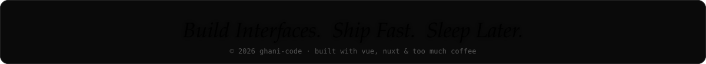

<a href="https://ghani-code.vercel.app">
  
</a>

<p align="center">
  <a href="https://readme-typing-svg.demolab.com">
    
  </a>
</p>

<p align="center">
  <a href="#about"><code>02 about</code></a> ·
  <a href="#skills"><code>03 skills</code></a> ·
  <a href="#work"><code>04 work</code></a> ·
  <a href="#stats"><code>05 stats</code></a> ·
  <a href="#contact"><code>06 contact</code></a> ·
  <a href="https://ghani-code.vercel.app/ghani-khalid-cv.pdf"><code>⌘ CV ↗</code></a>
</p>

<p align="center">
  <a href="https://ghani-code.vercel.app"></a>
  <a href="https://www.linkedin.com/in/ghani04"></a>
  <a href="mailto:abdulghanim70@gmail.com"></a>
  
</p>

<br />

<a id="about"></a>


> I'm a frontend developer who cares about **interfaces that feel inevitable** — where motion, copy, and structure quietly agree with each other.

Day to day it's **Nuxt, Vue, TypeScript and Tailwind CSS**, building interfaces for government facilities, agencies and product teams across Iraq. I'm learning the server side too, because knowing how the API works makes the frontend decisions sharper.

```jsonc
// $ cat resume.json
{
  "name":       "Abdulghani Khalid",
  "role":       "Frontend Developer",
  "location":   "Baghdad, Iraq · GMT+3",
  "education":  "Informatics Systems Management · UOITC · 2026",
  "experience": "2+ years",
  "focus":      ["Vue", "Nuxt", "TypeScript", "Tailwind"],
  "learning":   ["Backend Development", "C#", "Server Management"],
  "languages":  ["Arabic (native)", "English (professional)"],
  "offline":    ["self-help reads", "productivity hacks", "surviving in Minecraft ⛏️"]
}
```

<details>
<summary><b><code>$ ./fun-facts.sh</code></b> &nbsp;<sub>click to run</sub></summary>
<br />

```console
✨ started the coding journey in April 2024 — shipped to production soon after
✨ believe in "from zero to everything": small sparks grow into big builds
✨ graduation project XeroPhish got full marks (96.5% phishing detection accuracy)
✨ will absolutely nerd out about DX, theming systems and 60fps animations
⛏️ if I'm not answering, I'm probably surviving a Minecraft night
```

</details>

<br />

<a id="skills"></a>



<p align="center">
  <a href="https://skillicons.dev">
    
    <br />
    
  </a>
</p>

| `frontend` | `backend (learning)` | `others` |
| :-- | :-- | :-- |
| Vue · Nuxt · TypeScript · Tailwind · Pinia · React · Next.js | NestJS · PostgreSQL · C# · REST · WebSockets | Python · Flask · PHP · Rust · Flutter |

<br />

<a id="work"></a>


<table>
<tr>
<td width="50%" valign="top">

<sub><code>[001] vuetail.vue</code> · 2026 · live</sub>

### Vue-Tail Template
Vue 3 + TypeScript starter on **Vite 8, Rolldown & Tailwind v4**, with a CSS-variable-themed component library, file-based route registry and the Oxc toolchain.

[`live ↗`](https://vuetail-docs.vercel.app/) &nbsp; [`src ↗`](https://github.com/AbdulghaniKM/vuetail-template)

</td>
<td width="50%" valign="top">

<sub><code>[002] json-explorer.vue</code> · 2026 · live</sub>

### JSON Explorer
Browser-only JSON toolkit that opens **191 MB files**: flat typed-array index, Web Worker parsing and virtualized rendering. Diff, analyzer, type generators and a ⌘K palette.

[`live ↗`](https://the-json-explorer.vercel.app/)

</td>
</tr>
<tr>
<td width="50%" valign="top">

<sub><code>[003] jahiz.vue</code> · 2026 · live</sub>

### Jahiz
Privacy-first file converter with **92 conversions** across image, audio and data formats. Nothing is uploaded. Arabic-first, full RTL, works offline.

[`live ↗`](https://jahiz-web.vercel.app/ar)

</td>
<td width="50%" valign="top">

<sub><code>[004] xerophish.vue</code> · 2026 · graduation project</sub>

### XeroPhish
Dual-model ML phishing detector (Extra Trees + XGBoost, **96.5% accuracy**) with a glassmorphic Vue front, Flask back end and SHAP explanations. Full marks.

`Vue · Python · Flask · SHAP`

</td>
</tr>
<tr>
<td width="50%" valign="top">

<sub><code>[005] qalb.vue</code> · 2026 · live</sub>

### Qalb
Site for a Windows utility that fixes "اثممخ" → "hello" in one shortcut. Bilingual and RTL, with an in-browser demo of the flip.

[`live ↗`](https://qalb-shortcut.vercel.app/)

</td>
<td width="50%" valign="top">

<sub><code>[006] masarlink.vue</code> · 2026 · live</sub>

### MasarLink
Studio site for a Baghdad software team: animated ribbon hero, filterable case-study archive, bilingual RTL.

[`live ↗`](https://masarlink.org/)

</td>
</tr>
</table>

<details>
<summary><b><code>$ ls ./more-builds</code></b> &nbsp;<sub>13 more · click to expand</sub></summary>
<br />

| # | project | what it is | link |
| :-: | :-- | :-- | :-: |
| 007 | **ADHDx** | Healthcare information system: patient records and EEG-based ADHD decision support (capstone, full marks) | — |
| 008 | **Grain** | Memento-mori app that renders your life in weeks, with falling-sand particles and ambient audio | [↗](https://grain-calculator.vercel.app/) |
| 009 | **Idara** | Project management system for governmental projects, with reports and analytics | [web](https://idara-iq.com/) · [demo](https://demo.idara-iq.com/) |
| 010 | **BitXero** | Company website, built for accessibility and performance | [↗](https://bitxero-iq.com/) |
| 011 | **Scientific Affairs** | Role-based research-submission portal: JWT, Pinia, Zod and Excel reports | — |
| 012 | **Online Monitoring System** | Data monitoring for several ministries and Baghdad Municipality | — |
| 013 | **IQ Test Platform** | Annual IQ tests for the Ministry of Youth and Sports, online and onsite | — |
| 014 | **SuperHackathon 2025** | Hackathon platform (SuperNova × Ministry of Youth and Sports) | — |
| 015 | **DevSprint 2025** | Development-challenge platform | — |
| 016 | **Balance of Justice** | Web game for PDP 2025, sponsored by GIZ | — |
| 017 | **Constitution Ladder** | Web game for PDP 2025, sponsored by GIZ | — |
| 018 | **Cosmic** | Age calculator across the planets, with stardust effects | — |
| 019 | **this README** | You're looking at it. Hand-animated SVGs, no JS. | [src](./assets) |

<p align="right"><a href="https://ghani-code.vercel.app/#work"><code>full rundowns on ghani-code ↗</code></a></p>

</details>

<br />

<a id="stats"></a>


<p align="center">
  <a href="https://git.io/streak-stats">
    
  </a>
</p>

<p align="center">
  
</p>

<!-- contribution snake: re-enable once GitHub Actions can run on this account
     (run the "generate contribution snake" workflow, then restore this block)
<p align="center">
  <picture>
    <source media="(prefers-color-scheme: dark)" srcset="https://raw.githubusercontent.com/AbdulghaniKM/AbdulghaniKM/output/snake-dark.svg" />
    <source media="(prefers-color-scheme: light)" srcset="https://raw.githubusercontent.com/AbdulghaniKM/AbdulghaniKM/output/snake-light.svg" />
    
  </picture>
</p>
-->

<br />

<a id="contact"></a>


<details open>
<summary><b><code>$ ghani --contact</code></b></summary>
<br />

```yaml
status:    open to frontend roles, freelance & collabs
reply:     usually within a day (GMT+3)
topics:    Vue/Nuxt, DX, design systems, RTL interfaces… or anything, really
```

</details>

<p align="center">
  <a href="mailto:abdulghanim70@gmail.com"></a>
  <a href="https://www.linkedin.com/in/ghani04"></a>
  <a href="https://ghani-code.vercel.app"></a>
  <a href="https://ghani-code.vercel.app/ghani-khalid-cv.pdf"></a>
</p>

<br />



<p align="right"><a href="#readme"><code>back to top ↑</code></a></p>
